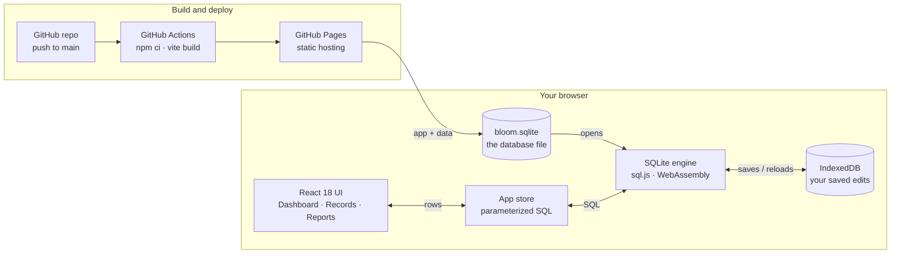

# Bloom IMS

An inventory management system for a polymer (plastics) trading desk. It tracks product lots in warehouses, purchase and sale contracts, ocean shipments, letters of credit, and the profit on every deal.

**[▶ Try the live demo](https://eze-io.github.io/bloom-ims/)**: no sign-up, just pick a role.

**Built with:** React 18 · Vite · SQLite (sql.js / WebAssembly) · IndexedDB · GitHub Pages · GitHub Actions

## How it runs today



| Layer | Today | Original (2020, AWS) |
| --- | --- | --- |
| **Front end** | React 18 + Vite, React Router | Angular on Elastic Beanstalk |
| **Database** | SQLite (bloom.sqlite) via sql.js / WebAssembly | Microsoft SQL Server on Amazon RDS |
| **Data access** | Parameterized SQL in the browser | C# Lambda functions behind API Gateway |
| **Business rules** | SQLite foreign keys, CHECK constraints, ON DELETE CASCADE | SQL Server constraints + cascade-delete triggers |
| **Saving edits** | IndexedDB in each visitor's browser | Shared RDS database |
| **Users and roles** | Demo roles + app_user table | Amazon Cognito user pools |
| **Hosting** | GitHub Pages | Elastic Beanstalk, CloudFront, Route 53 |
| **Deploys** | GitHub Actions on every push to main | AWS Lambda tools and Elastic Beanstalk deploys |

## The problem

The logistics team at a plastics trading company ran everything on spreadsheets and email. For each deal they had to work out:

- Do we have the product, and in which warehouse?
- Which trucker picks it up, and which vessel is it booked on?
- Which letter of credit backs the sale, and when is the document cutoff?
- Did the deal make money after fees?

This system puts all of that in one place and follows the team's real deal workflow, from the trader's email through to payment.

## What you can do in the demo

| Page | What it shows |
| --- | --- |
| **Dashboard** | Stock on hand, open contracts, shipments at sea, net P&L, inventory by warehouse, P&L per deal |
| **Records** | All 14 business tables from the original database, with search, sort, add, edit and delete |
| **Deal workflow** | A walkthrough of the logistics process the system was designed around |
| **Reports** | SQL queries (profit by customer, stock by warehouse, shipments by port and more), each with its SQL shown and a CSV download |
| **Users** | Administrator, Editor and Viewer roles (originally Amazon Cognito user pools) |

The data lives in a real **SQLite database**, and the database itself enforces the original rules:

- `CHECK` constraints: a lot can't hold more than 2,000 MT, its release date must come after its received date, and a letter of credit's ETA must come after its ETS.
- Deal P&L and gross must equal `sale − purchase` and `P&L − fees`. The form calculates them for you, and the database checks them.
- `ON DELETE CASCADE`: deleting an agent, counterparty, bill of lading, deal, incoterm or payment term also deletes its contracts. The original database used six triggers for this.
- Foreign keys: deleting something that other records still use is refused.

## How it was originally built (2020)

| Layer | Technology |
| --- | --- |
| Front end | Angular on AWS Elastic Beanstalk, with CloudFront and Route 53 |
| Sign-in | Amazon Cognito (Administrator and Editor user pools, email confirmation) |
| API | API Gateway + AWS Lambda functions in C# / .NET Core |
| Database | Microsoft SQL Server on Amazon RDS, in a private subnet |
| Storage | Amazon S3 for configuration, profile pictures and database backups |


The database started as a whiteboard sketch:


## How this demo works

The AWS environment has been shut down, so this repo rebuilds the app in **React** as a static site:

- **React 18 + Vite**, with React Router (hash routing, so deep links work on GitHub Pages).
- **SQLite in the browser.** The data ships as [`public/bloom.sqlite`](public/bloom.sqlite). [sql.js](https://github.com/sql-js/sql.js) (SQLite compiled to WebAssembly) opens it in the page, every screen reads it with SQL, and every add, edit and delete is a parameterized `INSERT`, `UPDATE` or `DELETE`.
- **Saving changes.** GitHub Pages can't accept writes, so the edited database is saved in your browser (IndexedDB). **Download .sqlite** gives you the file to open in any SQLite tool, and **Reset demo data** goes back to the published file.
- Every push to `main` builds the site and publishes it to GitHub Pages (`.github/workflows/deploy.yml`).

### The database

- [`db/schema.sql`](db/schema.sql) is the SQLite schema, ported from the original SQL Server design.
- [`db/seed.js`](db/seed.js) is the sample data, converted from the original load scripts.
- `npm run db:build` rebuilds `public/bloom.sqlite` from those two files. Some generated rows pointed to deals, shipment statuses and packaging statuses that never existed, so the build clears those references so foreign keys can be enforced. It prints what it cleared.

You can query the file directly:

```bash
sqlite3 public/bloom.sqlite "SELECT customer, SUM(gross) FROM link JOIN lc USING (lc_id) GROUP BY customer;"
```

### Run it locally

```bash
npm install
npm run dev
```

## Repository layout

```
src/                       The React app
  pages/                   Dashboard, Records, Reports, Workflow, Users, About, Login
  components/              Layout, data table, record form, icons
  lib/                     Table definitions, SQLite access (sql.js) and formatting
  store.jsx                App state: reads and writes the SQLite database
db/                        SQLite schema and sample data
scripts/build-db.mjs       Builds public/bloom.sqlite
public/bloom.sqlite        The database the site loads
public/docs/               Architecture diagram and whiteboard ERD
original/database/         SQL Server scripts: schema, triggers, lookup data, sample data
original/lambda-functions/ C# AWS Lambda functions (entities, reports, users, auth)
```

## Looking back: what I'd change

Rereading the 2020 code with fresh eyes, these are the improvements I'd make next:

1. **Credentials.** The functions originally read config with an access key written into the code. In this repo that's replaced with the Lambda's IAM role. The next step would be AWS Secrets Manager for the database password.
2. **Parameterized SQL.** The entity and report functions build SQL by joining strings together (`exec {0} {1}`, `insert into {0} ...`). Switching to `SqlParameter` would remove the risk of SQL injection.
3. **Built-in cascades.** The six cascade-delete triggers should be `FOREIGN KEY ... ON DELETE CASCADE`. The SQLite version in this repo now does this.
4. **A missing link.** `contract_details` has no `contract_id`, so contract lines can't be tied to their contract. That needs a foreign key.
5. **Cleaner sample data.** Some generated rows pointed to deals and statuses that don't exist, which the original SQL Server load let through. The SQLite build clears them so foreign keys can be enforced.

## Note on names

The company has been renamed to "Bloom", and every person, company and figure in the data is fictional.
